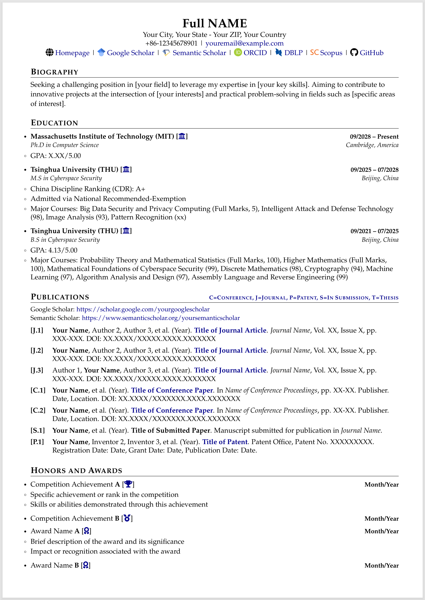
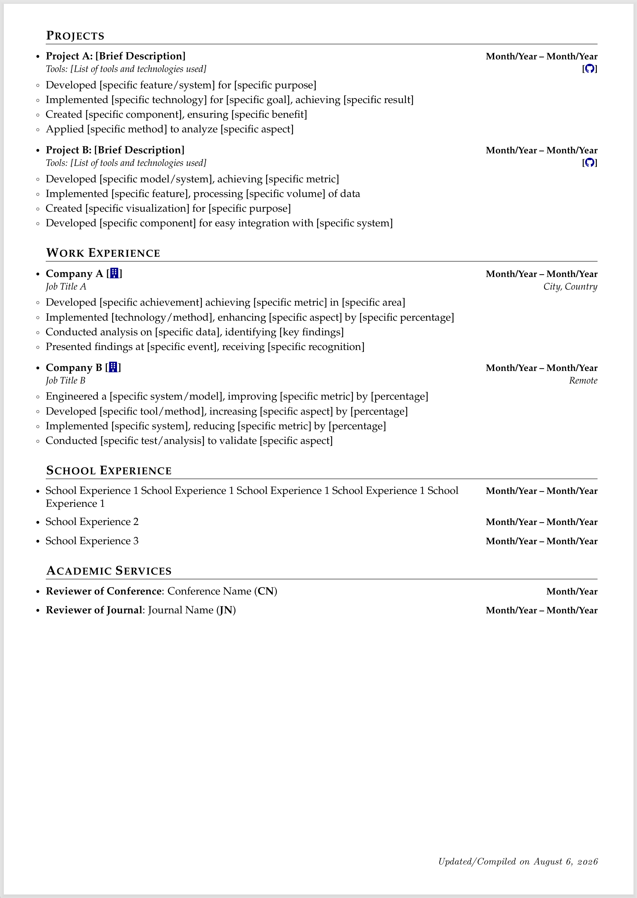
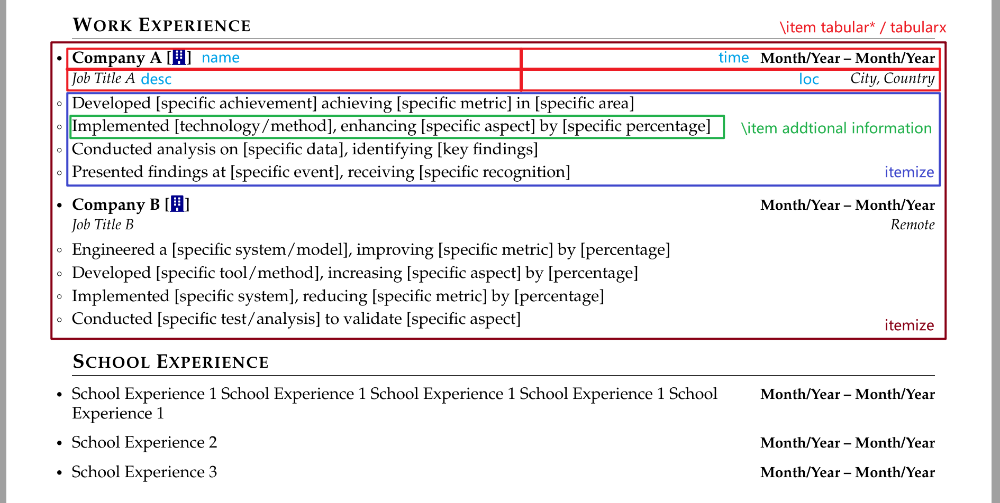
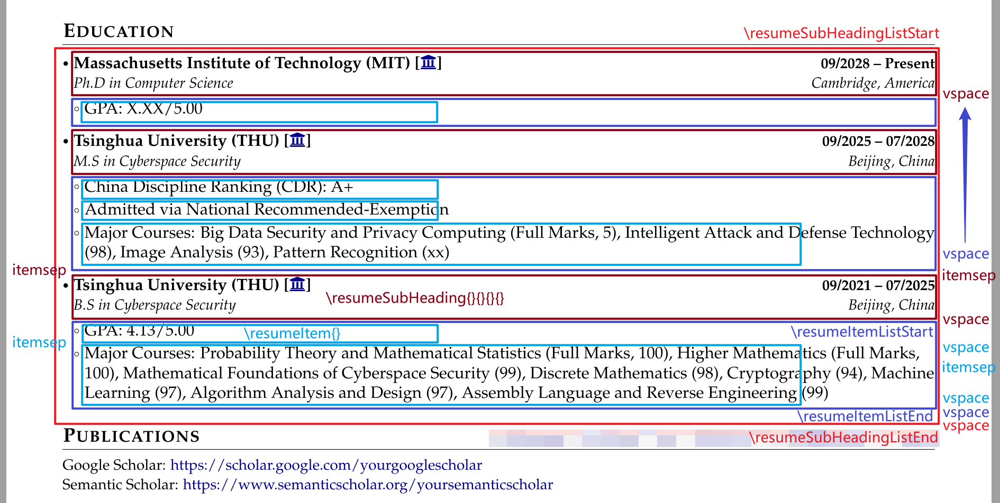
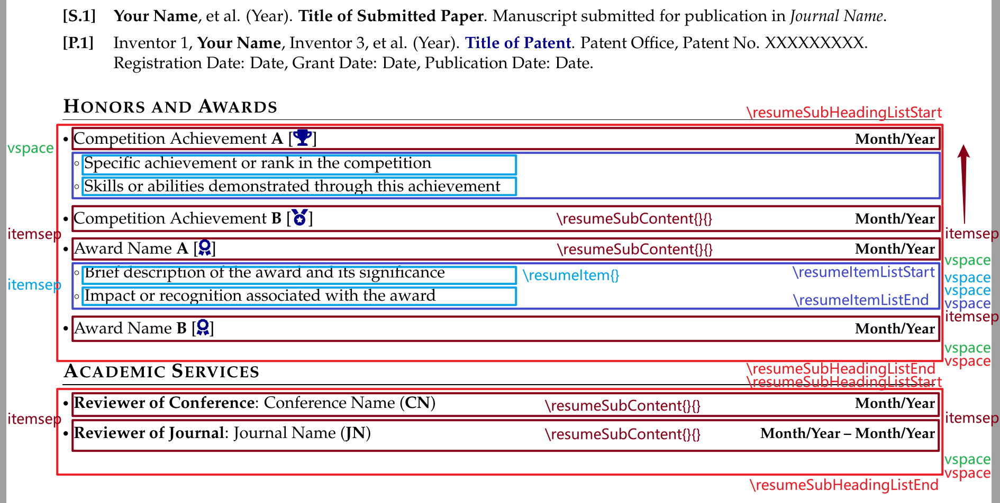

# Academic CV Template

[](README-zh.md)

## Overview: CV and Resume

Curricula vitae (CVs) are used to apply for teaching or research opportunities, fellowships, further academic training, grants, contract funding proposals, tenure, promotion to professor positions, and membership in a professional society or organization.

**Note**: In the United States, the term "resume" is used for industry and other non-academic positions. In some international settings, the term "CV" is used for all opportunities. However, you should tailor your document based on position type.

### CV vs. Resume

- CV: Comprehensive scholarly record; 2-3 pages for a graduate student, gets longer through a career.
- Resume: Brevity, relevance, efficiency; typically 1-2 pages (2 for PhDs or for those with more experience).

### Formatting CV

There is no single correct format or style for writing a CV – think about making it easy for your readers to skim and find the information they are looking for. Use a consistent format throughout, use an easy to read font, and make good use of descriptive section headings, subheadings, and white space to guide your reader.

Typically, CVs are longer than resumes. Unlike a resume, it is appropriate to describe both teaching and research experience in detail. If applying for a position that primarily involves research, describe research experience first; if the reverse is true, put teaching experience first. When describing your experience, include the goal, your contributions, and the impact/result of your contributions.

**Completeness is more important than brevity.** The length is typically 2 to 4 pages for a younger professional, 4 to 7 pages for a person with more experience.

### CV Headings

Headings can be located and titled strategically. Determine what is of primary importance, and put that section first.

- Name & Contact Information
- Education
- Research Interests
- Publications, including Journal Articles, Conference Papers, Books, Patents, and Manuscripts Under Review
- Posters
- Fellowships/Grants/Awards/Honors
- Professional Experience, e.g., Research Experience, Teaching Experience, Mentoring Experience, Industry Experience, Government Experience
- Leadership
- Service Activities, e.g., Academic Service, Professional Experience
- Presentations, or Invited Talks
- Skills – may include subcategories such as Computer, Languages, Lab Instrumentation
- References

## Preview

<div style="display: flex; justify-content: space-between; align-items: flex-end;">
    
    
</div>

## Required Files

```
./
|--figure	# store image here
|--sec		# cv sections here
|--main.tex	# Edit cv here
```

## Edit Content

Edit your personal basic information in the preamble of `main.tex` as the **header content**, and edit different `.tex` files in the `sec/` directory as the corresponding **section content**.

### Options for Head

Different header style options are provided. Please use one of the following commands before `\input{sec/head}`:

```latex
\headstyleitrue		% onecolumn, simple version & no icons, suitable for digital edition
\headstyleiitrue	% onecolumn, simple version & with icons, suitable for digital edition
\headstyleiiitrue	% onecolumn, detailed version & no icons, suitable for print edition
\headstyleivtrue	% onecolumn, detailed version & with icons, suitable for print edition
\headstylevtrue		% twocolumn, no photo
\headstylevitrue	% twocolumn, with photo
```

Please note: there must be **one and only one** `\headstyle` set to `true` (e.g. `\headstyleitrue`)

### Options for Font

Different font options are provided. It is recommended to use one of the following commands right after `\begin{document}`:

```latex
\fontstylei		% Helvetica-like (similar to Arial/Calibri)
\fontstyleii	% Times-like (similar to Times New Roman)
\fontstyleiii	% Palatino (elegant serif)
\fontstyleiv	% Bookman (readable serif)
\fontstylev		% Avant Garde-like (similar to Trebuchet MS)
\fontstylevi	% Quasi-Helvetica (another Arial/Calibri alternative)
\fontstylevii	% Quasi-Times (another Times New Roman alternative)
\fontstyleviii	% Quasi-Palatino (another elegant serif option)
\fontstyleix	% Computer Modern Roman
\fontstylex		% Computer Modern Sans Serif
\fontstylexi	% Charter (clean serif font)
```

### Options for Alignment

Two alignment options are provided:

```latex
\justifyfalse	% left-align
\justifytrue	% justify
```

## Edit Template

### Header Content

You can freely edit the template in the `sec/head.tex` file:

- Set icon
- Set font size
- Set the information to display and format it
- ......

In the `onecolumn` style, this is mainly achieved using the `center` environment. In the `twocolumn` style, if there are no photo, left-right alignment of two columns is mainly achieved using the `\hfill` command, though the `tabular*` / `tabularx` **table environments** can achieve the same effect. If you want to display photo, the `\parbox{width}{content}` command is primarily used.

### Section Content

The reason for setting up different sections is to display **bullet points** in a more detailed way through categorization. When describing a bullet point, it should include these elements: **name, time, description (optional), location (optional), and additional information (optional)**. Different categories of bullet points have different requirements for these elements, and the **element requirement scenarios** may be divided into the following categories:

- All elements
- No need for loc, show icon link instead
- Just name and time
- Just name, time, and additional information

Set up two levels of `itemize` **list environments** in the template:

- **List environments**: (1) the first-level is the **primary (maximum)** list environment, which describes name, time, description, and location; (2) the second-level is the **secondary (minimum)** list environment, which describes additional information.
- **List environment commands**: (1) the first-level uses the `\resumeSubHeadingList` environment, and (2) the second-level uses the `\resumeItemList` environment; both are essentially `itemize` environments.
- **List item commands**: (1) the first-level uses the `\resumeSubHeading` / `\resumeSubProject` / `\resumeSubContent` commands, and (2) the second-level uses the `\resumeItem` command; both are essentially `\item` commands.

The first-level list item commands wraps a `tabular*` / `tabularx` **table environment**. The reason for implementing three list item commands is to adapt to the different **element requirement scenarios** mentioned above, which have different requirements for parameter count and display style, so they are implemented separately. Details are as follows:

```latex
\resumeSubHeadingListStart
% bullet point 1: All elements
\resumeSubHeading{name}{time}{desc}{loc}
  \resumeItemListStart
  \resumeItem{additional information 1}
  \resumeItem{additional information 2}
  \resumeItemListEnd
% bullet point 2: No need for loc, show icon link instead
\resumeSubProject{name}{time}{desc}{link}
  \resumeItemListStart
  \resumeItem{additional information 1}
  \resumeItem{additional information 2}
  \resumeItemListEnd
\resumeSubHeadingListEnd
```

```latex
\resumeSubHeadingListStart
% bullet point 3: Just name and time
\resumeSubContent{name}{time}
% bullet point 4: Just name, time, and additional information
\resumeSubContent{name}{time}
  \vspace{-7mm}
  \resumeItemListStart
  \resumeItem{additional information 1}
  \resumeItem{additional information 2}
  \resumeItemListEnd
\resumeSubHeadingListEnd
```



If there are **other element requirement scenarios** that the above scenarios do not cover, you can add other template commands.

### Control Alignment

Users can use the `\justifytrue` and `\justifyfalse` commands to achieve justified and left-aligned text, respectively. The alignment mentioned here has two meanings:

- The alignment of **plain text paragraphs**
- The alignment of **text in the left column of tables** (specifically for the `tabularx` table environment).

For **plain text paragraphs**, it is essentially controlled by the `\raggedright` command. If you do not set this command, the default is **justify**, and setting the command makes it **left-align**.

```latex
\ifjustify\else\raggedright\fi
```

In controlling the alignment of **table text**, the content in the right column is usually **time** or **location** (optional). These are short, so you do not need to worry about line breaks, and for aesthetic reasons, they should be **right-align**. The content in the left column is usually **name** or **description** (optional), which can be longer, so you need to consider line breaks, so alignment becomes a consideration. As mentioned above, the table environment is wrapped in the first-level list item commands and only involves the `tabular*` / `tabularx` table environment.

For the `tabular*` table environment, the column alignment options are `l/r/c`, but they do not support auto-wrapping (text will only auto-wrapping if you set a column width). So this table environment is only suitable for short text. If you have longer text that needs wrapping, sticking with `tabular*` can make the table spill over the page, so it is better to use the `tabularx` table environment.

For the `tabularx` table environment, a **stretchable column** type `X` is provided, which automatically calculates column width to enable text auto-wrapping. The `X` column is **justify** by default, and to achieve **left-align** while maintaining the stretchable width like `X`, the template defines a custom `L` column type.

```latex
\newcolumntype{L}{>{\raggedright\arraybackslash}X}%
```

### Control vspace

Controlling **vertical spacing** is a tricky issue and requires users to be very familiar with template commands. Ideally, we want different parts of the same file to have a consistent format, where vertical spacing can be flexibly controlled using the `\vspace` command. There might be situations where spacing between different modules adds up, and if we can not adjust that flexibly or ignore the overlapping, it will prevent us from getting the desired formatting output. For overlapping situations, for example:

> Suppose `\resumeItemListEnd` is set at the end with `\vspace{-1mm}`, and `\resumeItem` is unset. If we set `\vspace{-0.5mm}` after `\resumeItem` at this time, and ensure the spacing between the content of this command and `\resumeSubHeading` remains unchanged, we need to change the final `\vspace{-1mm}` of `\resumeItemListEnd` to `\vspace{-0.5mm}`, because $-1+0.5=-0.5$.

For the commands `\resumeSubHeadingListEnd`, `\resumeItemListEnd`, `\resumeSubHeading`, and `\resumeSubProject`, `\vspace` are all set. However, after the `\resumeSubContent` and `\resumeItem` commands, `\vspace` is not set, but the spacing between their list items is set as `itemsep`. Both this command and `\vspace` allow vertical spacing control, but `itemsep` does not allow spacing adjustment after the last `\item`.

**Intra-section spacing**: The reason the `\resumeSubContent` and `\resumeItem` commands do not set `\vspace` but use `itemsep` is because their contents are usually the **smallest list items**. However, the contents of `\resumeSubContent` are sometimes not the smallest list item, meaning there may be additional information later using the `\resumeItemList` environment. Therefore, to reduce the vertical spacing between `\resumeSubContent` and `\resumeItem`, it is recommended to use the `\vspace` command in the body rather than using it in the template command. Note: Using `\vspace` in template command makes it difficult to unify the vertical spacing between `\resumeSubContent` content and between it and `\resumeItem` content. As mentioned above, bullet point 4 uses `\vspace{-7mm}`.

**Inter-section spacing**: The content at the end of each section is usually the content of the `\resumeItem` command, but sometimes it can also be the content of the `\resumeSubContent` command. Even if `\resumeItem` does not use the `\vspace` command, it belongs to the `\resumeItemList` environment; because `\resumeItemListEnd` uses `\vspace` at the end, while `\resumeSubContent` does not use the `\vspace` command. To standardize vertical spacing between different sections, it is recommended to manually add `\vspace{0.6mm}` after `\resumeSubHeadingListEnd` in the `\resumeSubHeadingList` environment if ending with a `\resumeSubContent` list item.





### Control hspace

As mentioned above, the first-level list item commands wraps a `tabular*` / `tabularx` table environment, so to make the left edge of the table left column align with the left edge of the main text and the right edge of the table right column align with the right edge of the main text, you need to make the following settings:

(1) **Set the left margin of list item text to 0**: In the `itemize` list environment, you can align the left edge of the **list item text** with the left edge of the main text by setting the parameter `leftmargin=0mm`. Note: `leftmargin=*` only aligns the left edge of the **list item label** with the left edge of the main text; the distance from the left side of the label to the left boundary of the enclosing environment (for a top-level list, this is the left page margin) is `\leftmargin`+`\itemindent`-`\labelsep`-`\labelwidth`.

```latex
\begin{itemize}[leftmargin=0mm,labelsep=2mm,itemsep=0mm,itemindent=0mm]
```

(2) **Set tablewidth to linewidth**: In the `tabular*` / `tabularx` table environment, by specifying the table width to `\linewidtn` / `\textwidth`, the table width matches line width of the current environment / main text width. Note: Sometimes `\linewidth` is less than `\textwidth`, depending on the environment in which the table is located.

(3) **Set the column spacing and border thickness of the table to 0**: When there is a table environment, in addition to the width of the text inside the table, you also need to consider the column spacing `\tabcolsep` and the border thickness `\arrayrulewidth`. Note: In some table environments, even when borders are not displayed, they still occupy space.

```latex
\setlength{\tabcolsep}{0in}
\setlength{\arrayrulewidth}{0in}
```

## Chinese Support

This template currently does not support compiling Chinese, but if you need to compile Chinese, you need to make the following changes:

You can use `pdfLaTeX` to compile Chinese by just importing the package in the preamble:

```latex
\usepackage[UTF8]{ctex}
```

If you do not need English, you can just comment out the content below:

```latex
%\usepackage[T1]{fontenc}
%\usepackage{cfr-lm}
...
%% FONT OPTIONS
%\newcommand{\fontstylei}{\fontfamily{phv}\selectfont} % Helvetica-like (similar to Arial/Calibri)
%\newcommand{\fontstyleii}{\fontfamily{ptm}\selectfont} % Times-like (similar to Times New Roman)
%\newcommand{\fontstyleiii}{\fontfamily{ppl}\selectfont} % Palatino (elegant serif)
%\newcommand{\fontstyleiv}{\fontfamily{pbk}\selectfont} % Bookman (readable serif)
%\newcommand{\fontstylev}{\fontfamily{pag}\selectfont} % Avant Garde-like (similar to Trebuchet MS)
%\newcommand{\fontstylevi}{\fontfamily{qhv}\selectfont} % Quasi-Helvetica (another Arial/Calibri alternative)
%\newcommand{\fontstylevii}{\fontfamily{qtm}\selectfont} % Quasi-Times (another Times New Roman alternative)
%\newcommand{\fontstyleviii}{\fontfamily{qpl}\selectfont} % Quasi-Palatino (another elegant serif option)
%\newcommand{\fontstyleix}{\fontfamily{cmr}\selectfont} % Computer Modern Roman
%\newcommand{\fontstylex}{\fontfamily{cmss}\selectfont} % Computer Modern Sans Serif
%\newcommand{\fontstylexi}{\fontfamily{bch}\selectfont} % Charter (clean serif font)
...
%\fontstyleiii
```

